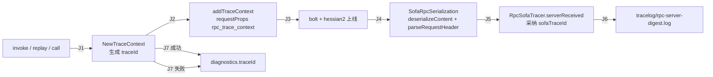

# SOFATracer traceId 透出 —— 端到端测试计划（Delta Plan）

- 计划模式：**Delta Plan**（验证对象是单个 bounded change：客户端自造 trace context 并回带 traceId，不改业务语义、不改已有请求的编码）
- 被验证改动（工作区未提交）：`internal/sofarpcwire/trace.go`（新）、`internal/sofarpcwire/wire.go`、`internal/core/invoke/direct.go`
- 真实目标：**本地一次性 SOFARPC provider** `bolt://127.0.0.1:21200`，`com.example.demo.EchoFacade#echo`，sofa-rpc-all 5.8.0 + tracer-core 3.0.8，SOFATracer 由 `sofa-rpc/rpc-config.json` 默认开启
- Execution handoff: `execution-anchors/v1`
- 输出语言：中文（代码标识符、路径、类名、错误码原文保留）

## Overview

**业务成果**：工程师/agent 调用一个 SOFARPC facade 后，能用工具返回的 `diagnostics.traceId` 在 provider 日志里定位到**这一次**调用。

**核心判据**：provider 端 SOFATracer 的 server span 必须采用**客户端生成的**那个 traceId，而不是自己新造一个。判据点在 `RpcSofaTracer.serverReceived` → `saveSpanContextAndTags`：读 `requestProps["rpc_trace_context"]` 的 `sofaTraceId`；读不到则 `spanContext == null`，服务端 `buildSpan().start()` 造新 id，客户端永远不知道。**因此"两个 id 字符串相等"是修复生效与失效的分界线**，不是近似指标。

**覆盖**：链路触达边 7 条；场景 8 个，全部 **read-only 且目标为本地一次性进程**——无业务环境、无 DB 写入、无生产数据。

**Top 风险**：① 本地 provider 用 sofa-rpc 5.8.0，业务侧版本可能不同（G2）；② `new_rpc_trace_context` 通道优先级高于本次使用的老通道，本地场景不可达（G3）；③ provider 未接 SOFATracer 时静默降级，无失败信号（G1）。

**开放缺口**：3 项，均已定性，见 §8。

## 1. Source Inventory

| 来源 | 用途 | 状态 |
|---|---|---|
| `internal/sofarpcwire/trace.go`（新增） | `TraceContext`、`NewTraceContext()`、`props()`、`localIPv4()`、`nextTraceSequence()` | confirmed by source |
| `internal/sofarpcwire/wire.go:36-38,100,159-168` | `RequestSpec.Trace` + `addTraceContext`（空 traceId 不写任何字节） | confirmed by source |
| `internal/core/invoke/direct.go:71-118` | 每次执行生成 trace；诊断表在 wire 调用**之前**建好；失败分支同样返回诊断 | confirmed by source |
| `com.alipay.sofa.rpc.common.RemotingConstants:102` | `RPC_TRACE_NAME = "rpc_trace_context"` | confirmed by source（sofa-rpc-all 5.8.0 sources） |
| `com.alipay.sofa.rpc.tracer.sofatracer.RpcSofaTracer#serverReceived/#saveSpanContextAndTags` | **期望结果权威**：服务端如何采纳 traceId、缺省如何自造 | confirmed by source |
| `com.alipay.common.tracer.core.utils.TracerCompatibleConstants` | key 集合：`sofaTraceId`/`sofaRpcId`/`samp`/`sofaCallerApp`/`sofaCallerIp` | confirmed by source |
| `com.alipay.common.tracer.core.generator.TraceIdGenerator` | id 格式：IP_16(8 hex) + millis(13) + seq(4) + PID | confirmed by source（tracer-core 3.0.8 sources） |
| `com.alipay.sofa.rpc.codec.bolt.SofaRpcSerialization#parseRequestHeader` | header/body 合并规则（body 已有 map 时 `putAll(empty)` 空操作，不覆盖） | confirmed by source |
| `sofa-rpc-all-5.8.0.jar!/sofa-rpc/rpc-config.json` | `default.tracer: sofaTracer`、`invoke.baggage.enable: true` 默认开启 | confirmed by source |
| `com.alipay.common.tracer.core.appender.TracerLogRootDaemon:59,69` | 日志根 `-Dlogging.path` → `<path>/tracelog/` | confirmed by source |
| `<tmp>/provider/`（本次搭建） | 一次性 provider：`EchoFacade`/`EchoFacadeImpl`/`ProviderMain`，已 `PROVIDER_READY port=21200` | confirmed by execution |

### 期望结果权威 vs 实现证据

| 项 | 权威 | 说明 |
|---|---|---|
| 服务端采纳规则 | **specified** —— SOFARPC 5.8.0 外部契约（`RpcSofaTracer`） | 与本次改动独立，不是自证 |
| traceId 字面格式 | **specified** —— `TraceIdGenerator` | 日志平台按前缀解析来源 IP/时间 |
| 「失败路径也返回 traceId」 | **specified** —— 本会话用户指令 + 本次改动文档承诺（README/SKILL.md/CHANGELOG） | 属产品决定，非外部契约 |
| 「connect-failed 时 traceId 不可检索」 | **specified** —— 本次改动在 SKILL.md/prompt 中写明的降级说明 | 需要被观察验证，否则文档即失真 |

## 2. Journey Graph



| 边 | 消费 | 产出 | 状态/副作用 | 来源 |
|---|---|---|---|---|
| J1 | 无 | `TraceContext{TraceID,RPCID=0,Sampled=true,CallerApp=sofarpc-cli,CallerIP}` | 无副作用；进程内序号 + 网卡地址缓存 | `trace.go:56-66` |
| J2 | TraceContext | `requestProps["rpc_trace_context"]`（值全为 String） | 无副作用；空 traceId 时零字节 | `wire.go:159-168` |
| J3 | requestProps + args | hessian2 请求体 | **网络请求（本地环回）** | `sofarpcwire/encoder.go` |
| J4 | 请求体 + bolt header | `SofaRequest.requestProps` | 服务端内存；header 侧为空 → 不覆盖 | `SofaRpcSerialization:288-300` |
| J5 | requestProps | server span（traceId = 客户端的） | 线程上下文 | `RpcSofaTracer:455-500` |
| J6 | server span | digest 日志行 | **写文件**（`<tmp>/provider/logs/tracelog/`，delete） | `TracerLogRootDaemon` |
| J7 | TraceContext | `diagnostics.traceId` | 无副作用；成功/失败同样返回 | `direct.go:81-89,108-111` |

## 3. Agent Execution Contract

- 目标只允许 `bolt://127.0.0.1:21200`（本会话自建的一次性 provider）。**不得**指向任何业务 provider。
- 真实调用需 `SOFARPC_ALLOW_INVOKE=true` 且项目 `allowedServices` 含被调 service；本计划使用临时 project root，不改动任何既有 `.sofarpc` 配置。
- provider 进程、`registry.local`、`logs/` 全部位于 `<tmp>`，生命周期 `delete`。
- 执行者负责：解析实际端口、启停 provider、采集日志、清理进程与临时目录。

## 4. Scenario Inventory

| ID | 族 | 优先级 | 切片 | 目的 | 判据 | 边 | 入口 | 副作用 | 生命周期 |
|---|---|---|---|---|---|---|---|---|---|
| S0 | 基线 | P1 | Core | provider 就绪且 SOFATracer 生效 | 进程输出 `PROVIDER_READY`；`tracelog/` 目录生成 | — | java | 起进程 | delete |
| S1 | **主判据** | **P0** | Core | 真实 provider 采纳客户端 traceId | CLI `diagnostics.traceId` **等于** provider `SERVER_TRACE traceId=` | J1–J5, J7 | CLI `call` | read-only | delete |
| S2 | 可检索性 | **P0** | Core | traceId 落进 digest 日志，可被日志平台按串检索 | `rpc-server-digest.log` 含该 traceId | J6 | 文件 | 写日志 | delete |
| S3 | 失败分支 | **P0** | Core | 超时仍回带 traceId | errcode `runtime.timeout` 且 `diagnostics.traceId` 非空 | J1–J3, J7 | CLI `call` | read-only | delete |
| S4 | 唯一性 | P1 | Core | 连续两次执行产生不同 traceId，各自可追 | 两次 traceId 不等；provider 两条 `SERVER_TRACE` 各自匹配 | J1–J6 | CLI `call` ×2 | read-only | delete |
| S5 | 共存回归 | P1 | Core | request baggage 与 trace 同时在场互不影响 | provider 同时读到 baggage 值与客户端 traceId | J2–J5 | CLI `call` | read-only | delete |
| S6 | 降级说明 | P1 | Extended | connect-failed 时 traceId 返回但服务端确无记录 | errcode `target.connect-failed`；traceId 非空；provider 日志**不含**该 id | J1, J7 | CLI `call` | read-only | delete |
| S7 | 调用方标识 | P2 | Extended | provider 侧能认出 agent 发起的调用 | digest 行或 span tag 含 `sofarpc-cli` | J5, J6 | 文件 | read-only | delete |

## 5. Test Scenarios（P0 + Core 展开）

### S1 —— 真实 provider 采纳客户端 traceId（主判据）

- **Preconditions**：S0 通过；provider 监听 `127.0.0.1:21200` 且导出 `com.example.demo.EchoFacade`；临时 project root 内 `.sofarpc/config.json` 的 `allowedServices` 含 `com.example.demo.EchoFacade`；`SOFARPC_ALLOW_INVOKE=true`。
- **Actions**：`sofarpc-mcp call -project <tmpproj> -service com.example.demo.EchoFacade -method echo -types java.lang.String -args '["hello"]' -direct-url bolt://127.0.0.1:21200`
- **Observes**：CLI JSON 输出的 `diagnostics.traceId`；provider stdout 的 `SERVER_TRACE traceId=<id>`。完成判据：两者均出现且可比对。业务时限：`business threshold: none specified`。
- **State Footprint**：读——provider 内存态；写——provider stdout 与 `<tmp>/provider/logs/`（`delete`）；外部效果：无。
- **Expected Results**：
  1. `diagnostics.traceId == SERVER_TRACE 的 traceId`（逐字符相等）；
  2. 该 id 匹配 `^[0-9a-f]{8}\d{13}\d{4}\d+$`；
  3. 业务结果 `echo:hello`；
  4. `SERVER_TRACE rpcId` 为服务端派生的子 span id（非空）。
- **Oracle / Expected Authority**：**specified** —— `RpcSofaTracer#serverReceived`（sofa-rpc-all 5.8.0）：`spanContext != null` 时 `new SofaTracerSpan(..., spanContext, tags)` 复用上游 traceId；`== null` 时新建。
- **Implementation Evidence**：`direct.go:76,87`（生成与上报）、`wire.go:100`（编码）、`EchoFacadeImpl#echo`（服务端读取 span）。

### S2 —— traceId 落进 digest 日志（可检索性）

- **Preconditions**：S1 已执行，持有 `TRACE_ID`。
- **Actions**：在 `<tmp>/provider/logs/tracelog/` 下按 `TRACE_ID` 检索。
- **Observes**：`rpc-server-digest.log`（或同目录 digest 文件）命中行数 ≥ 1。
- **State Footprint**：读——日志文件；写——无。
- **Expected Results**：命中 ≥ 1 行，且该行属于服务端 digest（非客户端）。这是"能用 traceId 查日志"这一业务成果的直接证据。
- **Oracle**：**derived** —— SOFATracer digest reporter 以 span 的 traceId 落盘；关系断言（S1 的 id ∈ 日志内容），不依赖具体日志格式。
- **Implementation Evidence**：`TracerLogRootDaemon:59,69`。

### S3 —— 超时仍回带 traceId

- **Preconditions**：一个只接受 TCP 连接、永不回包的监听端口。
- **Actions**：`sofarpc-mcp call ... -direct-url bolt://127.0.0.1:<deaf-port> -timeout-ms 200`
- **Observes**：CLI JSON 的 `error.code` 与 `diagnostics.traceId`。
- **State Footprint**：读写均无（连接后即超时）。
- **Expected Results**：`error.code == "runtime.timeout"`；`diagnostics.traceId` 非空且格式合法。
- **Oracle**：**specified** —— 本次改动的产品决定：超时时请求多半已达 provider，此刻最需要 traceId。
- **Implementation Evidence**：`direct.go:108-111`。

### S4 —— 每次执行的 trace 相互独立

- **Preconditions**：S1 通过。
- **Actions**：用同一组参数连续执行两次 `sofarpc-mcp call`。
- **Observes**：两次 `diagnostics.traceId`；provider 两条 `SERVER_TRACE`。
- **Expected Results**：两个 traceId 不相等；每个都能在 provider 侧找到对应记录。
- **Oracle**：**specified** —— 本次设计决定：trace 按执行生成、不写进 Plan，故重放不复用原 id。
- **Implementation Evidence**：`direct.go:73-76` 注释与实现。

### S5 —— baggage 与 trace 共存

- **Preconditions**：provider 侧 `invoke.baggage.enable` 默认 true；`EchoFacadeImpl` 打印 baggage。
- **Actions**：带 `invocationProperties`（literal 值）执行一次真实调用。
- **Observes**：provider stdout 中的 baggage 值与 traceId。
- **Expected Results**：baggage 值原样可读；traceId 仍与客户端一致——两个 requestProps 键互不干扰。
- **Oracle**：**derived** —— 两键在 `requestProps` 中并列（`wire.go:97-100`），互不覆盖。
- **Implementation Evidence**：`wire.go:129-168`。

## 6. Execution DAG

```
S0 ─┬─> S1 ─┬─> S2
    │       ├─> S4
    │       └─> S5
    └─> S3（独立，需 deaf 端口）
        S6（独立，需未监听端口）
        S7（依赖 S2 的日志）
```

## 7. Coverage Matrix

| 义务 | 层 | 承载 | 状态 |
|---|---|---|---|
| 空 trace 不改变编码字节 | unit | `TestBuildGenericRequest_OmitsEmptyTraceContext` + golden fixtures | 已有 |
| 键集合/字符串类型正确 | unit | `TestTraceContextProps_UsesTracerCompatibleKeys` | 已有 |
| id 格式与唯一性 | unit | `TestNewTraceContext_*` | 已有 |
| 上线字节与上报 id 一致 | integration | `TestExecuteDirectIfPossible_SendsTraceContextItReports` | 已有 |
| 超时路径回带 traceId | integration | `TestExecuteDirectIfPossible_ReportsTraceIdWhenInvokeTimesOut`、`TestInvoke_TimeoutStillReportsTraceId` | 已有 |
| replay 回带 traceId | integration | `TestReplay_PayloadDirectTransportRoundTrip` | 已有 |
| **服务端采纳同一 traceId** | **E2E** | **S1** | 本计划新增 |
| **traceId 可在 provider 日志检索** | **E2E** | **S2** | 本计划新增 |
| baggage 共存 | E2E | S5 | 本计划新增 |
| connect-failed 降级说明属实 | E2E | S6 | 本计划新增 |

## 8. Gaps / Assumptions / Questions

| ID | 类型 | 内容 | 处置 |
|---|---|---|---|
| G1 | 缺口 | provider **未接** SOFATracer 时静默降级（map 被忽略、无任何失败信号），本计划未构造该 provider | 已在 README/SKILL.md 写明；如需覆盖，另起一个 `default.tracer` 置空的 provider，非首批 |
| G2 | 假设（ASSUMED，接受人：本会话用户） | 本地 provider 为 sofa-rpc 5.8.0；业务侧版本可能不同。`rpc_trace_context` 自 5.x 起为稳定老通道，判据不依赖 5.8.0 特有行为 | 接受；真业务环境验证留待日志工具落地时一并做 |
| G3 | 缺口 | `new_rpc_trace_context`（新通道）在服务端优先级高于本次使用的老通道。sofarpc-cli 是链路起点、不会携带上游新通道内容，故本地不可达 | 记录不覆盖；若将来出现"经网关转发"的场景需重新评估 |

## 9. First Test Slice

**S0 → S1 → S2**。这三条一旦通过，"调用完拿 traceId 去 provider 日志里定位这次调用"这条业务成果即端到端成立；其余场景是边界与回归。
